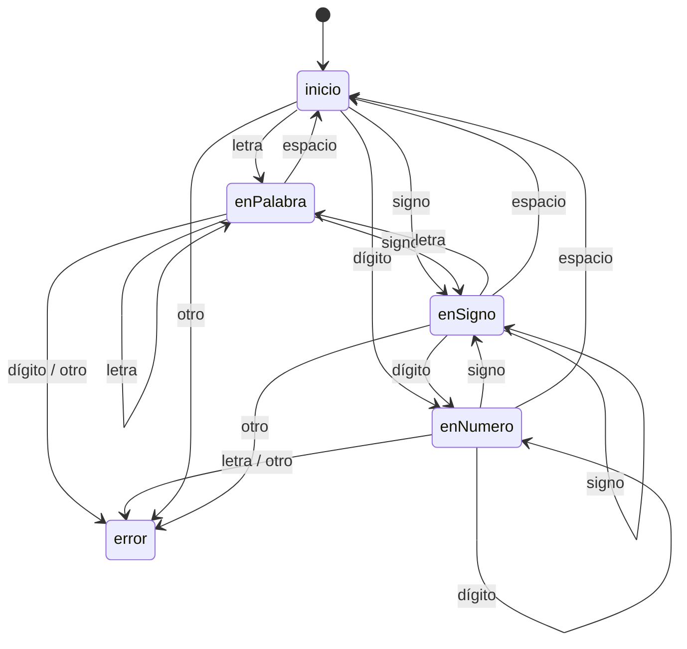
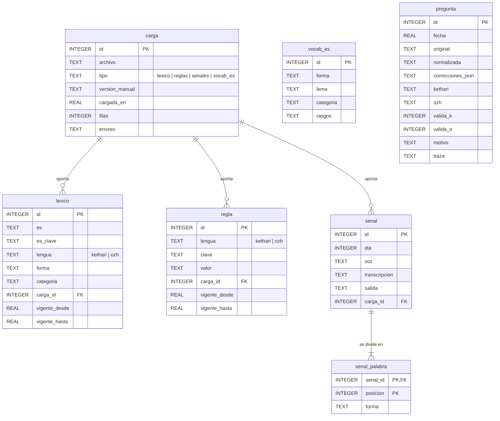
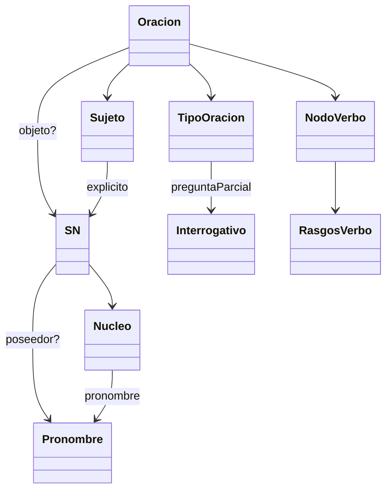

# Memoria

## BNF

Gramática del español que reconoce el analizador sintáctico (P2). Se escribió para un
analizador descendente recursivo: cada no terminal es una función con el mismo nombre
(`entrada()`, `clausula()`, `sintInterrog()`, `nucleo()`, `sv()`, `verbo()`, `sn()`,
`determinante()`, `nominal()`). La salida es el árbol intermedio (ver "Árbol intermedio").

### Terminales

La gramática no contiene ninguna palabra del español. Cada terminal es una **categoría**
de token que resuelven los datos (léxico y `vocab_es`) o la morfología:

| Terminal | Un token lo es si… | Ejemplos |
|---|---|---|
| `SIGNO` | es un token `.interrogacion` | ¿ ? |
| `NUM` | es un token `.numero(n)` (el analizador léxico ya convirtió el número) | 15, 9999 |
| `FIN` | es el token `.fin` | |
| `INTERROG` | tiene categoría `interrogativo` en el léxico o en `vocab_es` | qué, cuándo, dónde, cuántas, quién |
| `PRON` | tiene categoría `pronombre` en `vocab_es` | yo, ustedes, ellos |
| `ART` | tiene categoría `articulo` en `vocab_es` | el, una, los |
| `POS` | tiene categoría `posesivo` en `vocab_es` | su, nuestro, mis |
| `NEG` | tiene categoría `negacion` en `vocab_es` | no |
| `PREP` | tiene categoría `preposicion` en `vocab_es` | a |
| `SUST` | `Morfologia.analizarSustantivo` le da alguna lectura | paz, naves |
| `VERBO` | `Morfologia.analizarVerbo` le da alguna lectura | llegan, vendrán, fue |
| `INF` | `Morfologia.infinitivo` lo reconoce | llegar, ir |
| `VERBO_PERIF` | es un `VERBO` cuyo lema y tiempo coinciden con una fila `perifrasis` de `vocab_es` (`ir\|a\|perifrasis\|t=presente`) | van, vamos |

Una palabra puede pertenecer a varios terminales (sin tildes "el" es `ART` y `PRON`); la
regla R12 dice cómo se elige.

### Gramática

```
<entrada>        ::= [SIGNO] <clausula> [SIGNO] FIN
<clausula>       ::= <sint-interrog> <nucleo>
                   | <nucleo>
<sint-interrog>  ::= [PREP] INTERROG [<nominal>]
<nucleo>         ::= [<sn>] <sv> [<sn>] [<sn>]
<sv>             ::= [NEG] <verbo>
<verbo>          ::= VERBO_PERIF PREP INF
                   | VERBO
<sn>             ::= PRON
                   | [<determinante>] [NUM] <nominal>
<determinante>   ::= ART | POS
<nominal>        ::= SUST
```

Cada alternativa se elige mirando el token siguiente (y, solo en R12, uno más): no hay
retroceso.

| No terminal | Qué reconoce | Ejemplos |
|---|---|---|
| `<entrada>` | La frase completa. Los signos son opcionales al principio y al final, así se aceptan preguntas sin signos | "¿Cuándo llegan?", "cuando llegan" |
| `<clausula>` | Una frase con o sin palabra interrogativa al principio | "¿Cuántas naves llegaron?", "Queremos paz" |
| `<sint-interrog>` | La palabra interrogativa, con "a" delante y un nombre detrás opcionales | "a quién", "cuántas naves" |
| `<nucleo>` | Como mucho un sintagma antes del verbo, el verbo y hasta dos después | S V O, V S, V O, V S O |
| `<sv>` | El verbo con negación opcional | "no vimos" |
| `<verbo>` | Un verbo conjugado o el futuro "ir a + infinitivo" | "enviaron", "van a llegar" |
| `<sn>` | Un pronombre, o un nombre con determinante y número opcionales | "ustedes", "su planeta", "quince naves" |
| `<determinante>` | Artículo o posesivo | "los", "nuestro" |
| `<nominal>` | Un sustantivo en singular o plural | "paz", "naves" |

### Reglas que no caben en la BNF

La BNF dice qué secuencias son posibles; estas reglas deciden la concordancia, qué
función tiene cada sintagma y cómo se llena el árbol.

- **R1. Cantidades.** `NUM` debe estar entre 0 y 9 999 (constante `cantidadMaxima` del
  analizador: es el alcance del proyecto, no una regla de la lengua). Si `NUM ≠ 1`, el
  nombre va en plural ("quince naves", "0 naves"); con 1, en singular.
- **R2. Determinante y nombre concuerdan en número**, según el rasgo `n` del artículo o
  del posesivo: "los nave" o "nuestros mundo" son errores.
- **R3. Sujeto antes del verbo.** Un `<sn>` delante del verbo es el sujeto y tiene que
  concordar con él en persona y número. Para comparar se usa el rasgo `pv` del pronombre
  si existe, y si no `p`: "ustedes" (`p=2`, `pv=3`) concuerda con "vienen" (3.ª plural) y
  en el árbol queda como 2.ª persona. Un sustantivo cuenta como 3.ª persona.
- **R4. Sintagmas detrás del verbo.** Si todavía no hay sujeto, el primero que concuerda
  con el verbo es el sujeto ("¿Vienen ustedes?"); el otro es el objeto ("Queremos paz":
  *paz* es 3.ª singular y no concuerda con 1.ª plural). Como mucho hay un objeto.
  Cuando también hay un interrogativo que puede ser sujeto, el orden para elegir el
  sujeto es: (1) el sintagma de delante; (2) un **pronombre** de detrás que concuerde;
  (3) el interrogativo (R5); (4) un **nombre** de detrás que concuerde. Así en
  "¿Cuántos ciclos esperarán ustedes?" el sujeto es *ustedes* (y "cuántos ciclos" el
  objeto), y en "¿Quién envió el mensaje?" es *quién* (y "el mensaje" el objeto).
- **R5. Función del interrogativo**, según el rasgo `f` de `vocab_es`:
  `f=circunstancial` (cuándo, dónde) → circunstancial; `f=objeto` (qué) → objeto;
  `f=sujeto` (quién, cuántos) → sujeto si no hay otro sujeto, no lleva `PREP` delante y
  concuerda con el verbo, y si no, objeto. "¿Quién envió el mensaje?" → sujeto;
  "¿A quién escuchan ustedes?" → objeto; "¿Cuántas naves llegaron?" → sujeto. Para
  concordar, el interrogativo es 3.ª persona con el número de su nombre ("cuántas naves")
  o, si no lleva, el de su rasgo `n` (quién: singular). Con `f=objeto` y un nombre detrás,
  ese nombre es el objeto ("¿Cuántos ciclos…?"); los circunstanciales no llevan nombre.
- **R6. Lecturas ambiguas de la morfología.** Primero se quedan las lecturas del verbo
  que concuerdan con el sujeto (explícito o interrogativo); si queda más de una, se usa la
  primera en el orden de los datos ("enviamos" → presente). Si ninguna concuerda, es un
  error de concordancia con su columna. Con los posesivos igual: "su" → primer candidato.
- **R7. Sujeto omitido.** Si al final no hay sujeto, el sujeto es `.omitido` y la persona
  y el número salen del verbo ("¿Cuándo llegan?" → 3.ª plural).
- **R8. Tipo de oración.** Con `<sint-interrog>`, pregunta parcial. Si no, pregunta de
  sí/no cuando hay algún `SIGNO` o cuando hay **inversión con pronombre**: el sujeto va
  detrás del verbo y es un `PRON` ("vienen ustedes"). Si no, declarativa: "llegarán quince
  naves" (señal 3, voz Ozh) tiene el sujeto detrás pero es un nombre, y es una afirmación.
- **R9. Futuro con "ir a".** `VERBO_PERIF PREP INF` da el verbo del infinitivo, con la
  persona y el número de "ir", tiempo `.futuro` y `perifrastico = true`. La construcción
  está en los datos (`ir|a|perifrasis|t=presente`: el lema de la fila es la preposición
  que exige), así "ir" y "a" no están escritos en el código. Solo vale con "ir" en el
  tiempo de la fila: "fueron a ver" no es un futuro.
- **R10. Negación.** `NEG` delante del verbo da polaridad negativa, también delante del
  futuro con "ir a" ("no van a llegar").
- **R11. Posesivos.** El poseedor es el pronombre del lema del posesivo ("nuestro" →
  *nosotros*), con la persona y el número de la fila de ese pronombre.
- **R12. Palabras que coinciden sin tildes.** Las claves no tienen tildes, así que "el" y
  "él", "tu" y "tú" son la misma palabra. Si el token siguiente es `NUM` o `SUST`, es
  `ART` o `POS`; si no, es `PRON` ("el mensaje" / "¿Es él…?"). Si una palabra tiene
  lectura verbal y nominal, se prefiere la verbal cuando todavía no hay verbo.

### Ejemplos de análisis

| Entrada | Recorrido | Árbol |
|---|---|---|
| ¿Cuándo llegan? | SIGNO · sint-interrog(cuando) · nucleo(sv) · SIGNO | parcial(cuando, circunstancial) · S: omitido · V: llegar 3pl presente |
| cuando llegan | sint-interrog(cuando) · nucleo(sv) | igual: la palabra interrogativa basta (R8) |
| Queremos paz | nucleo(sv, sn) | declarativa · S: omitido · V: querer 1pl presente · O: paz (R4) |
| vienen ustedes | nucleo(sv, sn=PRON) | pregunta sí/no (R8: inversión con pronombre) |
| llegarán quince naves | nucleo(sv, sn) | declarativa · S: 15 nave+pl (R4, R8) |
| ¿Quién envió el mensaje? | sint-interrog(quien) · nucleo(sv, sn) | parcial(quien, sujeto) · S: interrogativo · O: mensaje (R5) |
| Ellos no van a llegar | nucleo(sn, sv(NEG, VERBO_PERIF PREP INF)) | V: llegar 3pl futuro (ir a) negativa (R9, R10) |
| Ellos visitaron nuestro mundo | nucleo(sn, sv, sn(POS, SUST)) | O: mundo de(nosotros) (R11) |

### Implementación

El analizador está en `Sources/AxiosCore/Sintaxis/` y se usa así:

```swift
let analizador = AnalizadorSintactico(lexicon: bd)
switch analizador.analizar(tokens) {           // Result<Oracion, ErrorSintactico>
case .success(let oracion): print(oracion.texto())
case .failure(let error):   print(error.texto())   // "columna 10: palabra desconocida 'xyz'"
}
```

| Archivo | Qué hay |
|---|---|
| `Clasificacion.swift` | Los terminales: `Clasificador` da a cada token sus categorías (`ClaseToken`) consultando `vocab_es` y la morfología. También `ErrorSintactico` (motivo, línea y columna) |
| `Parser.swift` | El estado: tokens, clase de cada uno y posición. `empiezaSN` y `esCantidadONombre` son los conjuntos FIRST que deciden cada alternativa |
| `Sintagmas.swift` | `sn()`, `determinante()`, `nominal()`, `sv()`, `verbo()`, con R1, R2, R9, R10, R11 y R12 |
| `Oracion.swift` | `entrada()`, `clausula()`, `sintInterrog()`, `nucleo()` y la construcción del árbol con R3 a R8 |
| `AnalizadorSintactico.swift` | La entrada pública `analizar(_:)` y la constante `cantidadMaxima` |

Cada no terminal es una función con el mismo nombre y su regla BNF en el comentario. El
análisis no retrocede: cada función mira el token actual (y en R12 el siguiente) para
decidir qué alternativa seguir. Antes de empezar, `entrada()` comprueba que todas las
palabras tengan alguna categoría; la primera que no, es un error con su columna.

Los no terminales devuelven estructuras intermedias (`SNAnalizado`, `VerboAnalizado`…)
que conservan el token y los datos de concordancia, y al final `construir` aplica las
reglas de papeles y tipo de oración y arma la `Oracion`. Las pruebas están en
`SintagmasTests` (cada no terminal por separado), `SintaxisTests` (frases del enunciado y
reglas R1 a R12) y `SenalesSintaxisTests` (la salida del decodificador de los días 1 a 7).

Alcance: las frases con adverbios ("antes", "ya"), pronombres átonos ("los vimos") o
indefinidos ("ninguna") quedan fuera de la gramática del enunciado y se rechazan con la
columna de la palabra que no encaja (señales 1, 4 y 6).

### Enganche con el pipeline y traza

El pipeline (P1) llama a P2 después del corrector, con los tokens corregidos:

```swift
var traza = Traza()                    // la misma que recorre todas las fases
let analizador = AnalizadorSintactico(lexicon: bd)
switch analizador.analizar(tokens, traza: &traza) {   // Result<Oracion, ErrorSintactico>
case .success(let oracion): // → generadores de Kethari y Ozh (P3)
case .failure(let error):   // → motivo del registro: error.texto()
}
```

Antes de analizar, `AdaptadorTokens.adaptar` deja los tokens como los espera la BNF sin
cambiar su texto ni su posición: corta en el primer `.fin` (y lo agrega si falta), quita
la puntuación que llegue como `.palabra` (".", ","), y convierte en `.interrogacion` o
`.numero` los signos y cifras que lleguen como `.palabra`. Si el analizador léxico
entrega exactamente el contrato de `Modelos.swift`, no cambia nada.

Cada paso de P2 agrega una fase a la traza (`axios traducir "…" --traza`):

```
[morfologia]    Cuándo: — | llegan: llegar 3pl presente
[clasificacion] ¿ SIGNO · Cuándo INTERROG · llegan VERBO · ? SIGNO · FIN
[sintaxis]      entrada[¿] › clausula[Cuándo] › sintInterrog[Cuándo] › nucleo[llegan] › sv[llegan] › verbo[llegan]
[arbol]         parcial(cuando, circunstancial) · S: omitido · V: llegar 3pl presente · O: —
```

| Fase | Qué muestra |
|---|---|
| `morfologia` | Las lecturas de cada palabra: verbo con sus rasgos (todas si es ambigua, separadas por "/"), `inf` si es infinitivo, `+pl` si es un sustantivo en plural, "—" si no tiene ninguna |
| `clasificacion` | Los terminales de la BNF de cada token; una palabra ambigua muestra todas sus categorías ("el PRON/ART") y una sin categoría, "desconocida" |
| `sintaxis` | El recorrido: cada no terminal visitado con el token donde empezó. Es la derivación por la BNF; si hay un error, termina en el no terminal donde falló |
| `arbol` | `Oracion.texto()`, o `error · columna N: motivo` |

## Normalizador

Primera fase del pipeline (`Sources/AxiosCore/Normalizacion/Normalizador.swift`). Deja la
pregunta como la espera el analizador léxico sin conocer ninguna palabra: solo usa las
clases de caracteres de Unicode.

| Entrada | Regla | Salida |
|---|---|---|
| `QUEREMOS Paz` | minúsculas | `queremos paz` |
| `¿Cuándo vendrán?` | sin tildes; "¿" y "?" se conservan | `¿cuando vendran?` |
| `AÑO` | la ñ se conserva (es otra letra) | `año` |
| `cu´ando` | acento suelto de otro teclado: se quita sin separar | `cuando` |
| `¿¿llegan???` | signos de pregunta repetidos cuentan como uno | `¿llegan?` |
| `¡Queremos paz!`, `naves,llegan.` | otra puntuación separa palabras | `queremos paz`, `naves llegan` |
| `9.999 naves` | entre dos cifras, la puntuación es separador de miles | `9999 naves` |
| `  cuando \t llegan ` | un solo espacio entre palabras, sin espacios en los extremos | `cuando llegan` |
| `nave$` | un símbolo que no es puntuación se deja; lo rechaza el analizador léxico | `nave$` |

El resultado es un `TextoNormalizado`: el texto y, para cada carácter, su columna en la
entrada original (`columnaOriginal(_:)`). En `"¿CUÁNDO   llegan?"` la *l* de *llegan* está
en la columna 9 del texto normalizado y en la 11 del original. Así los errores del
analizador léxico y del sintáctico señalan lo que escribió el usuario.

### Números en letras

Con un `Lexicon` (`Normalizador(lexicon: bd)`), el normalizador cambia los números
escritos en letras por cifras (`NumerosEnLetras.swift`). Las palabras están en
`data/numeros_es_v0.7.txt` (categoría `numeral` de `vocab_es`), con su valor `v` y su `tipo`:

| tipo | Ejemplos | Valor |
|---|---|---|
| `unidad` | cero, quince, veintiséis | 0 a 29 |
| `decena` | treinta, noventa | 30 a 90 |
| `centena` | cien, ciento, doscientas | 100 a 900 |
| `mil` | mil | multiplica el grupo anterior |
| `conector` | y | une decena y unidad |

Cada grupo de tres cifras es `[centena] [decena [y unidad] | unidad]`, y "mil" multiplica
el grupo que tiene delante (o 1 si va solo): "nueve mil novecientos noventa y nueve" →
9 × 1000 + 900 + 90 + 9 = 9999. Se lee el número más largo posible; una palabra que no
encaja empieza otro ("dos tres" → "2 3"). "un"/"una" llevan `solo=compuesto`: no empiezan
un número, así "una nave" queda igual y "treinta y una naves" pasa a "31 naves". Las
cifras toman la columna de la primera palabra del número. Un valor mayor que 9 999 se
convierte igual y lo rechaza la regla R1 del analizador sintáctico.

## Autómata

El analizador léxico del español (`Sources/AxiosCore/Lexico/AnalizadorLexico.swift`) es
un AFD escrito a mano con su tabla de transiciones explícita. Recibe el texto ya
normalizado y produce los tokens del contrato de `Modelos.swift` (`.palabra`,
`.numero(Int)`, `.interrogacion`, `.fin`) con la columna que tenían en la entrada original.

Clases de caracteres: **letra** (incluida la ñ), **dígito** (0-9), **signo** (¿ ?),
**espacio** y **otro**.

| Estado \ Clase | letra | dígito | signo | espacio | otro |
|---|---|---|---|---|---|
| **inicio** (aceptación) | enPalabra | enNumero | enSigno | inicio | error |
| **enPalabra** (aceptación) | enPalabra | error | enSigno | inicio | error |
| **enNumero** (aceptación) | error | enNumero | enSigno | inicio | error |
| **enSigno** (aceptación) | enPalabra | enNumero | enSigno | inicio | error |
| **error** (sumidero) | — | — | — | — | — |



- Un token termina cuando el autómata cambia de estado: `enPalabra → inicio` cierra una
  palabra y `enNumero → enSigno` cierra un número. Cada signo es un token aparte, también
  si van seguidos.
- Al terminar la entrada se cierra el último token y se agrega `.fin`, con la columna que
  sigue al final del texto original.
- Errores, con la columna original: carácter no válido (`nave$`), cifra pegada a una
  palabra (`nave1`), letra pegada a un número (`15naves`) y número demasiado grande para
  un `Int`. Un número mayor que 9 999 no es error léxico: lo rechaza el sintáctico (R1).
- `AnalizadorLexico.texto(_:)` da la línea de la traza:
  `¿ SIGNO@1 · cuando PALABRA@2 · llegan PALABRA@9 · 15 NUM@16 · ? SIGNO@18 · FIN@19`.

## Corrector

El corrector (`Sources/AxiosCore/Correccion/Corrector.swift`) recibe los tokens del
analizador léxico y cambia cada palabra mal escrita por la más cercana del vocabulario
español, con una distancia de Levenshtein propia.

```
corregir(palabra):
    si está en el vocabulario o la morfología la reconoce → no se toca
    umbral ← 0 si tiene ≤ 2 letras, 1 si tiene ≤ 4, 2 si tiene más
    candidatas ← vocabulario + formas generadas que la morfología reconoce
    elegir la candidata a menor distancia
    si la distancia > umbral o hay empate → no se corrige
```

- **Distancia de Levenshtein:** el mínimo de inserciones, borrados y sustituciones de
  letras. Se calcula con programación dinámica guardando solo dos filas de la tabla
  (`Corrector.distancia`).
- **Formas generadas:** las formas regulares ("llegan", "naves") no están en
  `vocabularioEspanol()` porque la morfología las analiza. Para cada final de la palabra
  que sea una terminación de `vocab_es` se prueban los verbos y sustantivos conocidos con
  ese final: "lelgan" termina en "-an", así que se prueba "llegan" (llegar + -an), y gana
  con distancia 2.
- **No altera palabras válidas:** antes de buscar candidatas se pregunta a
  `Morfologia.reconoce`, así "vendrán", "fue" o "enviaron" no se tocan.
- **Si no sabe, no cambia nada:** una palabra muy distinta o con dos candidatas a la
  misma distancia se deja igual, y el analizador sintáctico la rechaza como desconocida.
- Cada token corregido conserva su columna. `Corrector.texto(_:)` da la línea de la
  traza: `kuando → cuando (1) · lelgan → llegan (2)`.

## Morfología

La morfología (`Sources/AxiosCore/Morfologia/Morfologia.swift`) recibe una palabra y
dice qué es: de "vendrán" saca *venir, 3.ª persona plural, futuro*; de "naves", *nave en
plural*. No hay ninguna terminación ni ningún verbo escrito en el código: todo está en
`data/vocab_es_v0.7.txt` (tabla `vocab_es`) y en el léxico. El código solo trae el
algoritmo, así que un verbo regular nuevo funciona con solo agregarlo al léxico, y un
irregular se arregla con una fila de datos.

### Datos (`vocab_es`)

| Categoría | Ejemplo | Para qué sirve |
|---|---|---|
| `terminacion_presente` / `_pasado` / `_futuro` | `-aron\|ar\|terminacion_pasado\|p=3;n=pl;t=pasado;base=raiz` | Qué persona, número y tiempo marca una terminación, y a qué clase de verbo (-ar, -er, -ir) se aplica |
| `raiz_irregular` | `vendr-\|venir\|raiz_irregular\|t=futuro` | Raíz que sustituye a la regular en un tiempo |
| `raiz_excluida` | `ven-\|venir\|raiz_excluida\|t=pasado` | Raíz regular que el verbo no usa en ese tiempo |
| `verbo` | `fue\|ser,ir\|verbo\|p=3;n=sg;t=pasado` | Forma supletiva: se toma entera |
| `infinitivo` | `ir\|ir\|infinitivo\|` | Verbo sin traducción propia en el léxico |
| `terminacion_plural` | `-ces\|z\|terminacion_plural\|n=pl` | Plural de los sustantivos (el lema es lo que se repone) |

`base=infinitivo` indica que la terminación va pegada al infinitivo entero (el futuro:
llegar-án); `base=raiz`, que va pegada a la raíz (lleg-an). `clase=er` en una raíz
irregular dice con qué clase se conjuga si no es la de su verbo (estuv-ieron).

### Algoritmo para un verbo

```
analizarVerbo(forma):
    c ← clave(forma)                                  # minúsculas, sin tildes
    si c es una forma supletiva → devolver sus lecturas (un rasgo por cada lema)
    para cada corte, de la terminación más larga a la más corta:
        raíz ← c[..corte]    terminación ← "-" + c[corte..]
        para cada fila de terminación verbal con esa forma:
            irregulares ← lemas de "raíz-" como raiz_irregular en ese tiempo
            regulares   ← si base=infinitivo: [raíz]  si no: [raíz + clase] por clase
                          menos los lemas de "raíz-" como raiz_excluida en ese tiempo
            quedarse con los que son verbos conocidos (léxico o infinitivo de vocab_es)
        si hubo alguna lectura → devolverlas todas (sin repetir)
    devolver []
```

Ejemplos:

| Forma | Corte que funciona | Lectura |
|---|---|---|
| enviaron | envi + -aron (pasado, -ar) | enviar 3pl pasado |
| vendrán | vendr + -an (futuro, raíz irregular) | venir 3pl futuro |
| vienen | vien + -en (presente, raíz irregular, venir es -ir) | venir 3pl presente |
| queremos | quer + -emos (presente, -er) | querer 1pl presente |
| venimos | ven + -imos | venir 1pl presente (el pasado se descarta: `ven-` está excluida) |
| enviamos | envi + -amos | enviar 1pl presente **y** enviar 1pl pasado |
| van | forma supletiva | ir 3pl presente |

Si una forma tiene varias lecturas se devuelven todas, en el orden del archivo de datos:
la morfología no adivina, y el analizador sintáctico elige con el contexto. Para los
sustantivos se hace lo mismo con `terminacion_plural`: "luces" → luc + -es → luz.

### Interfaz

- `analizarVerbo(_:) -> [AnalisisVerbal]`: lecturas como verbo conjugado (rasgos,
  procedencia regular/raíz irregular/supletiva y terminación usada).
- `infinitivo(_:) -> String?`: el infinitivo si la forma lo es ("ir a + infinitivo").
- `analizarSustantivo(_:) -> [AnalisisNominal]`: lema en singular y número.
- `etiquetar(_ tokens:) -> [AnalisisToken]`: todo lo anterior para cada token `.palabra`,
  con su posición; `Morfologia.texto(_:)` es la línea de la traza. "Van a llegar" sale
  como `van: ir 3pl presente | a: — | llegar: inf llegar`: el futuro perifrástico lo
  reconoce el analizador sintáctico, porque abarca tres palabras.
- `reconoce(_:) -> Bool`: para el corrector ortográfico. Las formas regulares ("llegan")
  no están en `vocabularioEspanol()` porque se analizan; el corrector debe preguntar aquí
  antes de corregir una palabra.

## Modelo de datos

El esquema está en `Sources/AxiosCore/Recursos/schema.sql` y se puede ejecutar varias
veces sin error (`CREATE ... IF NOT EXISTS`).



**carga.** Registra cada archivo importado: nombre, tipo (`lexico`, `reglas`, `senales`
o `vocab_es`), versión del manual, momento de la carga, filas aceptadas y errores
encontrados. Sirve de auditoría: cada fila de `lexico`, `regla` y `senal` apunta a la
carga que la trajo, así se sabe de qué versión del manual viene un dato.

**lexico.** Diccionario español → Kethari/Ozh. Hay una fila por palabra española y
lengua; `es` guarda la palabra tal como aparece en el manual y `es_clave` la forma
normalizada que se usa para buscar. `forma` es la palabra en la lengua destino y
`categoria` su clase (pronombre, sustantivo, verbo, interrogativo, número). Tiene dos
índices: por español (para traducir) y por forma (para la orden `palabra` y para cruzar
con las señales).

**regla.** Parámetros gramaticales de cada lengua como pares clave/valor: orden de la
oración, sufijos y marcas de tiempo, negación, partículas, base numérica, etc. El
traductor lee estas reglas en vez de tenerlas escritas en el código, por eso cambiar la
gramática no obliga a recompilar.

**senal.** Las señales recibidas: día, voz (kethari, ozh o desconocida), transcripción y
la salida del decodificador. La restricción `UNIQUE (dia, voz, transcripcion)` evita
duplicar una señal si el mismo archivo se carga dos veces.

**senal_palabra.** La transcripción de cada señal partida en palabras con su posición.
Permite preguntar en qué señales aparece una forma y compararla con el léxico. Se borra
en cascada con su señal.

**vocab_es.** Vocabulario español con lema, categoría y rasgos (por ejemplo persona,
número y tiempo de un verbo conjugado). Lo usan el corrector ortográfico y el análisis
morfológico para reconocer palabras de la pregunta.

**pregunta.** Historial de traducciones: la pregunta original, su versión normalizada,
las correcciones ortográficas aplicadas (JSON), el resultado en cada lengua, si cada
traducción pasó la validación, el motivo si no, y la traza de las fases. El índice por
`fecha` sirve a la orden `historial desde <fecha>`.

### Versionado de léxico y reglas

Una corrección del manual **no borra filas**. Cuando llega un significado nuevo, la fila
vigente se cierra poniendo `vigente_hasta = ahora` y se inserta otra con
`vigente_desde = ahora` y `vigente_hasta = NULL`. Así siempre se puede responder "qué
significaba X en la fecha F":

```sql
SELECT forma FROM lexico
WHERE es_clave = :x AND lengua = :lengua
  AND vigente_desde <= :f
  AND (vigente_hasta IS NULL OR vigente_hasta > :f);
```

La traducción actual es la fila con `vigente_hasta IS NULL`. Las fechas se guardan como
`REAL` (segundos Unix con fracción, `Date.timeIntervalSince1970`) para que las
comparaciones sean exactas y no dependan del formato de texto ni de la zona horaria.

## Validadores

Los validadores comprueban si una frase en Kethari u Ozh es gramatical. Están en
`Sources/AxiosCore/Validacion/` y se usan desde la CLI con
`axios validar <kethari|ozh> "<frase>"`. Responden con un `ResultadoValidacion`: si es
válida, la estructura reconocida (por ejemplo `[S ir] [O yorr] [V mi] [PREG]`); si no, el
motivo y la columna donde está el problema.

### Tokenizador (AFD)

`TokenizadorAlien` es un autómata finito determinista escrito a mano, con la tabla de
transiciones explícita en el código (sin expresiones regulares). Separa la frase en
palabras con su columna y solo admite el guion entre dos letras (números como `a-b`).

Clases de caracteres: **letra** (cualquier letra, incluidas `ʔ` y `ü`), **guion** (`-`),
**espacio** y **otro**.

| Estado \ Clase | letra | guion | espacio | otro |
|---|---|---|---|---|
| **inicio** (aceptación) | enPalabra | error | inicio | error |
| **enPalabra** (aceptación) | enPalabra | trasGuion | inicio | error |
| **trasGuion** | enPalabra | error | error | error |
| **error** (sumidero) | — | — | — | — |

- `inicio → enPalabra` abre una palabra y guarda su columna; `enPalabra → inicio` la cierra.
- El estado `trasGuion` existe porque después de un guion solo puede venir una letra:
  así se rechazan `ra-` (guion al final), `-sel` (guion al inicio) y `a--b` (dos guiones).
- Si la entrada termina en `trasGuion` también es error. Al final se agrega un token `fin`.
- Cualquier carácter de la clase **otro** (`#`, cifras, signos) es error con su columna.

### BNF de Kethari

```
<oracion>  ::= [<interrog>] <sn>* <verbo> [<preg>]
<sn>       ::= <pronombre> | [<numero>] [<pronombre>] <nombre>
<nombre>   ::= raiz-sustantivo [sufijo_plural]
<verbo>    ::= [prefijo_negacion] raiz-verbo [sufijo_pasado | sufijo_futuro]
<numero>   ::= <cifra> { separador_numero <cifra> }
<preg>     ::= particula_pregunta
```

Restricciones que se comprueban además de la gramática:

- Sujeto obligatorio: antes del verbo hay al menos un `<sn>` o un `<interrog>`.
- Si hay `<interrog>`, la `<preg>` final es obligatoria.
- Un número mayor que 1 delante de un nombre exige `sufijo_plural` en el nombre.
- Cada cifra debe existir en Kethari y el valor debe ser menor que base^6.
- El verbo va al final; solo puede seguirle la `<preg>`.
- Un pronombre seguido de un nombre es poseedor + nombre cuando ya hay sujeto; si es el
  primer sintagma, el pronombre es el sujeto (`ir yorr mi ka` → `[S ir] [O yorr]`).

Análisis de afijos: primero se busca la palabra completa en el léxico (así los pronombres
plurales, que el manual define como palabras propias, no se confunden con raíz + plural);
si no está, se quitan el prefijo y los sufijos que dicen las reglas y se busca la raíz con
la categoría que corresponde (plural solo en sustantivos, tiempo y negación solo en verbos).

### BNF de Ozh

```
<oracion>   ::= [<tiempo>] [negacion] <verbo> <particula> <sn> {<sn>} [<interrog>]
<tiempo>    ::= marca_pasado | marca_futuro
<verbo>     ::= [prefijo_pregunta] raiz-verbo
<particula> ::= una de la regla "particulas"
<sn>        ::= <pronombre> | [<numero>] <nombre> [<pronombre>]
<numero>    ::= <cifra> { separador_numero <cifra> }
```

Restricciones:

- Una sola marca de tiempo y solo al inicio.
- La partícula va justo después del verbo.
- Sujeto obligatorio: al menos un `<sn>` después de la partícula.
- El `<interrog>` solo puede ir al final y solo si el verbo lleva `prefijo_pregunta`.
- Los nombres no llevan plural: una forma con sufijo no existe en el léxico de Ozh y se
  rechaza como palabra desconocida.
- El poseedor va detrás del nombre (`thüm ʔenka`).

### Implementación

Cada no terminal es una función del analizador descendente recursivo (`oracion`, `sn`,
`nombre`, `verbo`, `numero`, `preg` en Kethari; `oracion`, `tiempo`, `verbo`, `particula`,
`sn`, `nombre`, `numero` en Ozh). Antes de analizar se comprueba que todas las palabras se
puedan clasificar; la primera que no, se informa como `palabra desconocida` con su columna.

Ninguna palabra, afijo ni partícula está escrita en el código: las categorías salen del
léxico (`Lexicon.categoria`), los afijos, marcas, partículas, base y separador de las
reglas (`Lexicon.regla`), y el valor de cada cifra de la traducción de "0", "1", "2"...
Si el manual cambia una regla, basta con cargarla.

### Independencia del generador (rúbrica #13)

Los validadores no importan ni llaman a ninguna función de generación (traducción). Solo
dependen del protocolo `Lexicon` y del tokenizador. Así comprueban lo que produce el
generador de forma independiente: si el generador tuviera un error, el validador no lo
heredaría, y una frase mal generada se rechaza. Un test usa un `LexiconFalso` con palabras
inventadas para demostrar que la gramática no depende de ningún vocabulario concreto.

## Árbol intermedio

El analizador sintáctico no produce texto en otra lengua: produce un árbol (`Oracion`, en
`Sources/AxiosCore/Arbol/ArbolIntermedio.swift`) que describe la pregunta en términos del
español y que leen los dos generadores. Así hay un solo análisis del español y dos
generadores que no se conocen entre sí; agregar una lengua nueva sería escribir solo su
generador.



- **Oracion**: tipo (declarativa, pregunta de sí/no o pregunta parcial con su
  interrogativo), sujeto, verbo y objeto opcional.
- **Sujeto**: explícito (un SN), omitido (persona y número salen del verbo) o el propio
  interrogativo ("¿Quién…?").
- **SN**: núcleo (pronombre o sustantivo con su número), cantidad ya convertida a número y
  poseedor opcional. Los artículos no se guardan.
- **NodoVerbo**: `RasgosVerbo` (infinitivo, persona, número, tiempo), polaridad y la marca
  `perifrastico` para el futuro con "ir a".
- **Interrogativo**: su lema y qué pregunta (sujeto, objeto o circunstancia).

La pregunta parcial lleva el interrogativo como valor asociado del tipo, así no se puede
construir una pregunta parcial sin interrogativo ni una declarativa con uno. El contrato
completo, con reglas y ejemplos para los generadores, está en `docs/contrato-arbol.md`.

## Generadores de Kethari y Ozh

Están en `Sources/AxiosCore/Traduccion/`. Reciben la `Oracion` del árbol intermedio y no
vuelven a mirar el español. Toda palabra sale de `Lexicon.traduccion` y todo orden, afijo,
partícula y posición de `Lexicon.regla`: en el código no hay ninguna palabra de Kethari ni
de Ozh.

| Pieza | Qué hace |
|-------|----------|
| `ConversorNumeros` | Escribe un número dividiendo entre la `base` de la lengua (6 en Kethari, 10 en Ozh) y uniendo las cifras con `separador_numero`: 15 → `ra-sel` / `ois-ulo`. Límite: valor < base^6, el mismo que el validador |
| `BaseGenerador` | Lo común: buscar palabras y reglas, reponer el sujeto omitido desde `vocab_es`, colocar S, O y V según `orden`, y armar el sintagma `[número] [poseedor] nombre` según `posicion_numero` y `posicion_poseedor` |
| `GeneradorKethari` | SOV; `nu-` + raíz + `-ok`/`-ime`; plural `-esh` (obligatorio si el número es mayor que 1); interrogativo al inicio y `ka` al final; "nosotros" siempre `anir` |
| `GeneradorOzh` | `[ʔoka/venu] [ne]` + VSO con partícula detrás del verbo (`zi` en afirmaciones, `mar` en preguntas); `ʔa-` en el verbo de toda pregunta e interrogativo al final; sin plural; poseedor detrás |

Cada generador tiene dos entradas: `generar` (estricta: una palabra sin traducción es un
error) y `traducir` (la que usa el traductor: devuelve una `Traduccion` con el texto y las
palabras sin respaldo explicadas). Las decisiones (base 6, anir, partícula, ʔoka, corchetes)
están en la bitácora con fecha y test.

## Pipeline y traza

`Pipeline.traducir` (`Sources/AxiosCore/Pipeline/Pipeline.swift`) une todas las fases. Tiene
la firma de `CLI.Traductor`, así la CLI lo recibe sin cambiar su código.

```
pregunta
  → Normalizador (P1)          minúsculas, tildes, signos, números en letras
  → AnalizadorLexico (P1)      AFD: tokens con su columna original
  → Corrector (P1)             Levenshtein contra el vocabulario
  → AnalizadorSintactico (P2)  morfología, BNF y árbol intermedio
  → GeneradorKethari / GeneradorOzh (P3)
  → validarKethari / validarOzh (P4)
  → Retrotraductor (P1)        lo aprobado, de vuelta al español
  → RegistroPregunta           la CLI lo guarda siempre en la BD
```

Cómo cumple las tres condiciones de Axios:

| Condición | Qué hace el pipeline |
|---|---|
| 1. Ninguna pregunta se pierde | Siempre devuelve un `RegistroPregunta`. Si una fase falla, el motivo dice cuál y en qué columna ("error léxico: columna 14: carácter no válido '$'") |
| 2. No sale lo que no se puede volver a leer | Cada traducción pasa por su validador; si la rechaza queda marcada como rechazada y el motivo dice por qué |
| 3. No se inventa nada | Si el generador retuvo alguna palabra sin respaldo, esa lengua queda sin traducción y el motivo explica la palabra. La otra lengua sale igual |

Con `axios traducir "<pregunta>" --traza` se ve cada fase:

```
[entrada]         ¿Cuándo llegarán nuestras cinco naves?
[normalizacion]   ¿cuando llegaran nuestras 5 naves?
[lexico]          ¿ SIGNO@1 · cuando PALABRA@2 · llegaran PALABRA@9 · nuestras PALABRA@18 · 5 NUM@27 · …
[correccion]      sin cambios
[morfologia]      … (P2)
[clasificacion]   … (P2)
[sintaxis]        … (P2)
[arbol]           parcial(cuando, circunstancial) · S: 5 nave+pl de(nosotros) · V: llegar 3pl futuro · O: —
[kethari]         kom pai anir kumesh vinime ka
[ozh]             venu ʔasur mar ulo gor ʔenka wem
[validacion]      kethari: válida [INT kom] [S pai anir kumesh] [V vinime] [PREG] | ozh: válida …
[retrotraduccion] K: ¿cuándo · 5 nave de nosotros · llegar/venir [futuro]? | O: …
```

## Retrotraducción

`Retrotraductor` (`Sources/AxiosCore/Retrotraduccion/Retrotraductor.swift`) devuelve al
español una frase en Kethari u Ozh. Sirve para comprobar qué se va a transmitir y qué se
creía en una fecha que significaba cada palabra.

1. Valida la frase con `validarKethari` / `validarOzh`. Si no es válida, no se
   retrotraduce: se devuelve el motivo y la columna.
2. Lee la estructura que da el validador (`[INT kom] [S ulesh] [V vinime] [PREG]`).
3. Busca cada palabra con `significados(forma:lengua:en:)`, en la fecha pedida o con lo
   vigente. Los afijos (plural, negación, tiempo, pregunta) y las marcas de tiempo salen de
   las reglas; los números se leen en la base de cada lengua.
4. Arma una glosa en orden español: interrogativo · sujeto · verbo · objeto.

| Lengua | Frase | Retrotraducción |
|---|---|---|
| Kethari | kom ulesh vinime ka | ¿cuándo · ustedes · llegar/venir [futuro]? |
| Kethari | ra-sel kumesh vinok | 15 nave · llegar/venir [pasado] |
| Kethari | anir ulesh nukorok | nosotros · no ver [pasado] · ustedes |
| Ozh | ʔasur mar shavi wem | ¿cuándo · ustedes · llegar/venir [mar]? |
| Ozh | ʔoka kesh zi oruvi thüm ʔenka | ellas/ellos · visitar [pasado] · mundo/planeta de nosotros/nosotros incluyente [zi] |

Es una glosa y no español conjugado: con varios significados se muestran todos
("llegar/venir") y la partícula de Ozh queda entre corchetes, como en el decodificador,
porque su significado no está en los datos. Con fecha, "iresh tekaesh nuthal" da
"tierra" antes de la corrección de la semana 2 y "territorio reclamado" después.

## Análisis de errores

### Traducción (P3)

Los generadores distinguen tres clases de problema y nunca inventan una forma:

| Clase | Ejemplo | Qué pasa |
|-------|---------|----------|
| Palabra sin respaldo: no está en el léxico | "ir" como verbo principal: está en `vocab_es` (para "ir a") pero no en `lexico` | Se retiene: `[ir]`, "ir: no está en el léxico, no se puede traducir a Kethari" |
| Palabra sin respaldo: sin forma en la lengua | "tierra" en Kethari tras la corrección de la semana 2 (teka pasó a "territorio reclamado") | Se retiene: `iresh [tierra] nuthal`; en Ozh sigue siendo `mak` y la frase sale completa |
| Número no representable | 50 000 en Kethari (necesita 7 cifras en base 6) | Se retiene en cifras: `[50000] kumesh vinok`, con el motivo |
| Dato roto | Falta la regla `orden` o `marca_pasado`, o `particula_afirmacion` no está en `particulas` | Es un error (`ErrorGeneracion.faltaRegla`): no se genera la frase, porque el problema no es de la pregunta sino de los datos |

La palabra retenida queda en español, entre corchetes y sin afijos (`[correr]`, no
`nu[correr]ok`), para que se vea qué parte no es de la lengua destino. El validador no
acepta los corchetes, así que una traducción incompleta nunca se registra como válida.

**Diferencias conocidas con las señales.** Las frases generadas son válidas en su lengua,
pero no siempre iguales a la transcripción, por decisiones documentadas:

- Kethari, señales 2 y 7: sale `anir` donde la señal trae `anul`, porque el español no dice
  si el oyente está incluido y se decidió no adivinarlo.
- Ozh, partícula: con `zi` para afirmar y `mar` para preguntar coinciden las señales 1, 4, 5
  y 8; la 2, 3, 9 y 10 traen `tho` y la 6 y 7 traen `mar` en afirmaciones.
- Ozh, señal 4: "No vimos ninguna nave" no trae `ʔoka`; el generador lo pone porque lo
  dice `marca_pasado`.

### Casos no traducibles

- **"¿Quién llegó?" en Ozh.** Con el interrogativo como sujeto y sin objeto sale
  `ʔoka ʔasur mar wis`, y el validador la rechaza: Ozh exige al menos un sintagma después
  de la partícula, y el interrogativo va al final, fuera de ese hueco. En Kethari sí se
  traduce (`sem vinok ka`), porque allí el interrogativo puede hacer de sujeto. Para
  resolverlo haría falta que el manual diga dónde va un interrogativo sujeto en Ozh.
- **"¿Cuántos ciclos esperarán ustedes?" en Kethari** se traduce, pero el interrogativo
  queda separado de su nombre (`kai ulesh lunesh tepime ka`), porque la regla
  `posicion_interrogativo = inicio` lo manda al principio de la frase.
- **Frases que no llegan a los generadores.** Las que el analizador sintáctico rechaza
  ("Antes enviamos…", "no los vimos a ustedes", "ninguna nave", la voz desconocida de la
  señal 6, "Ya los escuchamos") se informan con su columna en esa fase (bitácora
  2026-11-21) y no se intentan traducir.

### Pruebas que lo respaldan

`ParesTests.testOchoParesDeNumerosYPosesivos` lleva ocho frases en español por el
analizador sintáctico, los dos generadores y los dos validadores con los datos reales:
números en base 6 y 10 (6, 15, 26, 36 y 12) y posesivos delante y detrás, también en una
pregunta. Los casos de error están en `DesconocidasTests`, `GeneradorKethariTests`,
`GeneradorOzhTests` y `NumerosTests`.

## Declaración de uso de IA
