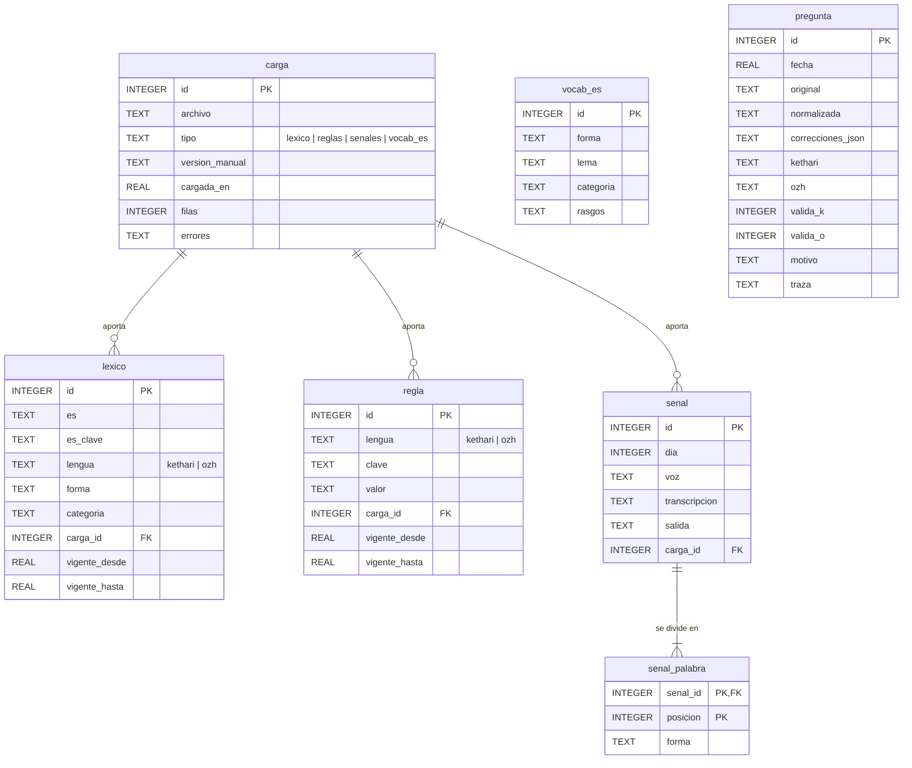

# Memoria

## BNF

## Autómata

## Modelo de datos

El esquema está en `Sources/AxiosCore/Recursos/schema.sql` y se puede ejecutar varias
veces sin error (`CREATE ... IF NOT EXISTS`).



**carga.** Registra cada archivo importado: nombre, tipo (`lexico`, `reglas`, `senales`
o `vocab_es`), versión del manual, momento de la carga, filas aceptadas y errores
encontrados. Sirve de auditoría: cada fila de `lexico`, `regla` y `senal` apunta a la
carga que la trajo, así se sabe de qué versión del manual viene un dato.

**lexico.** Diccionario español → Kethari/Ozh. Hay una fila por palabra española y
lengua; `es` guarda la palabra tal como aparece en el manual y `es_clave` la forma
normalizada que se usa para buscar. `forma` es la palabra en la lengua destino y
`categoria` su clase (pronombre, sustantivo, verbo, interrogativo, número). Tiene dos
índices: por español (para traducir) y por forma (para la orden `palabra` y para cruzar
con las señales).

**regla.** Parámetros gramaticales de cada lengua como pares clave/valor: orden de la
oración, sufijos y marcas de tiempo, negación, partículas, base numérica, etc. El
traductor lee estas reglas en vez de tenerlas escritas en el código, por eso cambiar la
gramática no obliga a recompilar.

**senal.** Las señales recibidas: día, voz (kethari, ozh o desconocida), transcripción y
la salida del decodificador. La restricción `UNIQUE (dia, voz, transcripcion)` evita
duplicar una señal si el mismo archivo se carga dos veces.

**senal_palabra.** La transcripción de cada señal partida en palabras con su posición.
Permite preguntar en qué señales aparece una forma y compararla con el léxico. Se borra
en cascada con su señal.

**vocab_es.** Vocabulario español con lema, categoría y rasgos (por ejemplo persona,
número y tiempo de un verbo conjugado). Lo usan el corrector ortográfico y el análisis
morfológico para reconocer palabras de la pregunta.

**pregunta.** Historial de traducciones: la pregunta original, su versión normalizada,
las correcciones ortográficas aplicadas (JSON), el resultado en cada lengua, si cada
traducción pasó la validación, el motivo si no, y la traza de las fases. El índice por
`fecha` sirve a la orden `historial desde <fecha>`.

### Versionado de léxico y reglas

Una corrección del manual **no borra filas**. Cuando llega un significado nuevo, la fila
vigente se cierra poniendo `vigente_hasta = ahora` y se inserta otra con
`vigente_desde = ahora` y `vigente_hasta = NULL`. Así siempre se puede responder "qué
significaba X en la fecha F":

```sql
SELECT forma FROM lexico
WHERE es_clave = :x AND lengua = :lengua
  AND vigente_desde <= :f
  AND (vigente_hasta IS NULL OR vigente_hasta > :f);
```

La traducción actual es la fila con `vigente_hasta IS NULL`. Las fechas se guardan como
`REAL` (segundos Unix con fracción, `Date.timeIntervalSince1970`) para que las
comparaciones sean exactas y no dependan del formato de texto ni de la zona horaria.

## Análisis de errores

## Declaración de uso de IA
