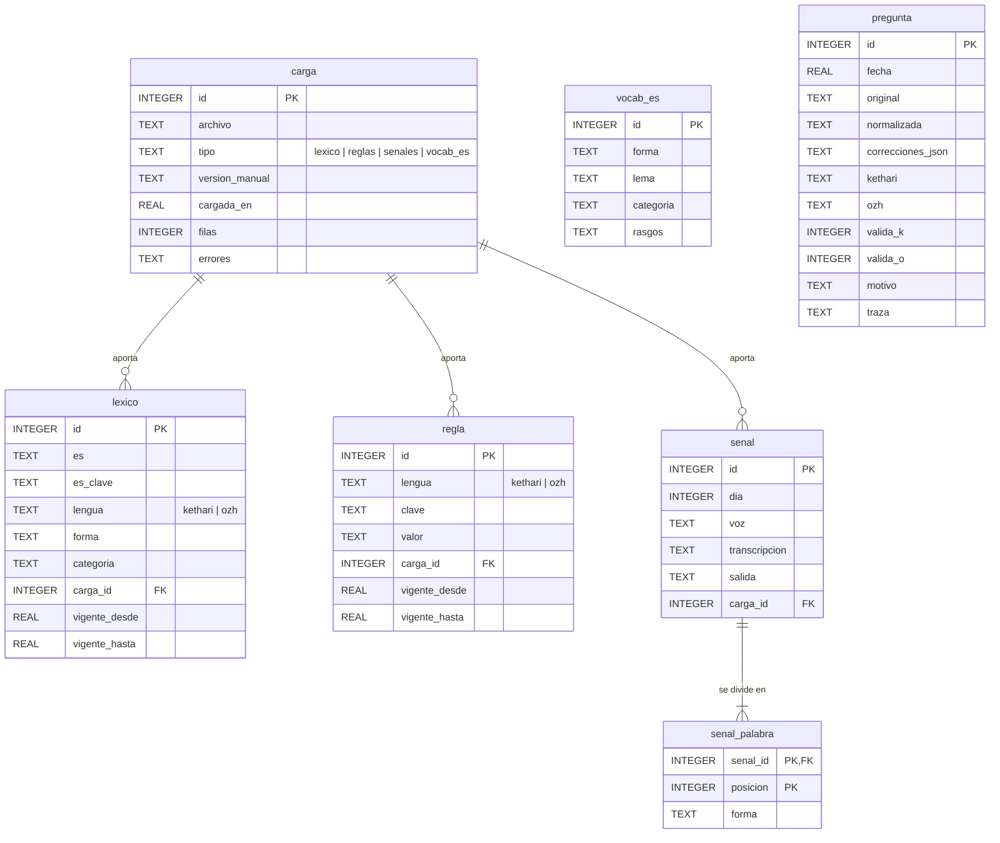
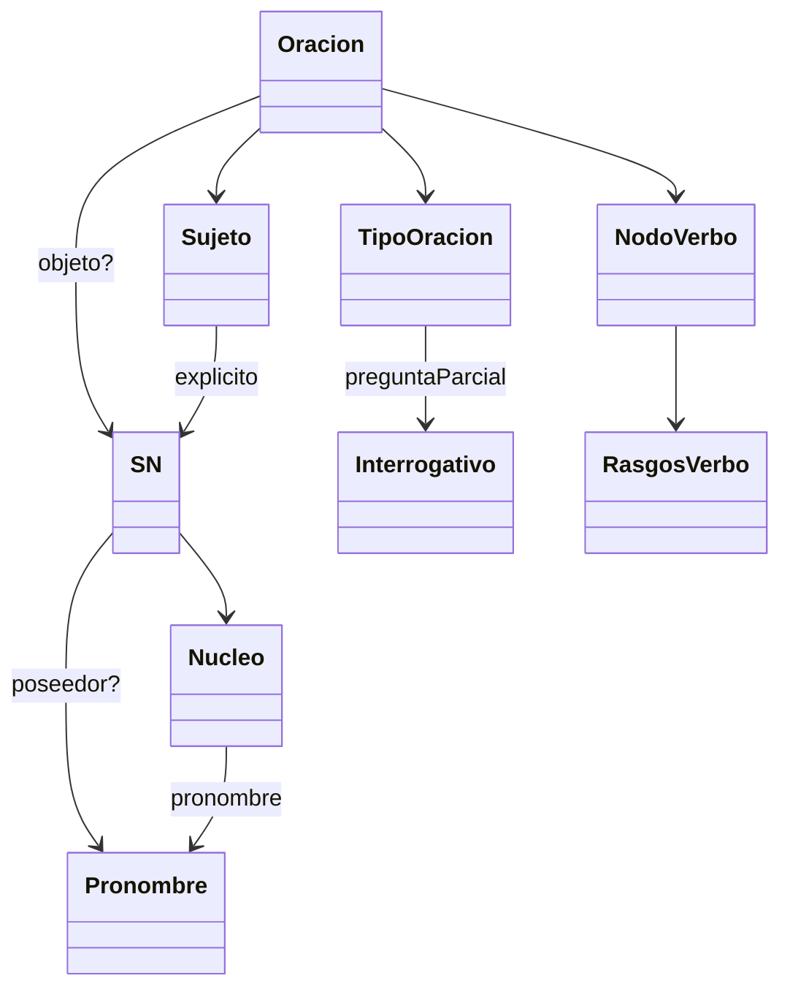

# Memoria

## BNF

## Autómata

## Modelo de datos

El esquema está en `Sources/AxiosCore/Recursos/schema.sql` y se puede ejecutar varias
veces sin error (`CREATE ... IF NOT EXISTS`).



**carga.** Registra cada archivo importado: nombre, tipo (`lexico`, `reglas`, `senales`
o `vocab_es`), versión del manual, momento de la carga, filas aceptadas y errores
encontrados. Sirve de auditoría: cada fila de `lexico`, `regla` y `senal` apunta a la
carga que la trajo, así se sabe de qué versión del manual viene un dato.

**lexico.** Diccionario español → Kethari/Ozh. Hay una fila por palabra española y
lengua; `es` guarda la palabra tal como aparece en el manual y `es_clave` la forma
normalizada que se usa para buscar. `forma` es la palabra en la lengua destino y
`categoria` su clase (pronombre, sustantivo, verbo, interrogativo, número). Tiene dos
índices: por español (para traducir) y por forma (para la orden `palabra` y para cruzar
con las señales).

**regla.** Parámetros gramaticales de cada lengua como pares clave/valor: orden de la
oración, sufijos y marcas de tiempo, negación, partículas, base numérica, etc. El
traductor lee estas reglas en vez de tenerlas escritas en el código, por eso cambiar la
gramática no obliga a recompilar.

**senal.** Las señales recibidas: día, voz (kethari, ozh o desconocida), transcripción y
la salida del decodificador. La restricción `UNIQUE (dia, voz, transcripcion)` evita
duplicar una señal si el mismo archivo se carga dos veces.

**senal_palabra.** La transcripción de cada señal partida en palabras con su posición.
Permite preguntar en qué señales aparece una forma y compararla con el léxico. Se borra
en cascada con su señal.

**vocab_es.** Vocabulario español con lema, categoría y rasgos (por ejemplo persona,
número y tiempo de un verbo conjugado). Lo usan el corrector ortográfico y el análisis
morfológico para reconocer palabras de la pregunta.

**pregunta.** Historial de traducciones: la pregunta original, su versión normalizada,
las correcciones ortográficas aplicadas (JSON), el resultado en cada lengua, si cada
traducción pasó la validación, el motivo si no, y la traza de las fases. El índice por
`fecha` sirve a la orden `historial desde <fecha>`.

### Versionado de léxico y reglas

Una corrección del manual **no borra filas**. Cuando llega un significado nuevo, la fila
vigente se cierra poniendo `vigente_hasta = ahora` y se inserta otra con
`vigente_desde = ahora` y `vigente_hasta = NULL`. Así siempre se puede responder "qué
significaba X en la fecha F":

```sql
SELECT forma FROM lexico
WHERE es_clave = :x AND lengua = :lengua
  AND vigente_desde <= :f
  AND (vigente_hasta IS NULL OR vigente_hasta > :f);
```

La traducción actual es la fila con `vigente_hasta IS NULL`. Las fechas se guardan como
`REAL` (segundos Unix con fracción, `Date.timeIntervalSince1970`) para que las
comparaciones sean exactas y no dependan del formato de texto ni de la zona horaria.

## Validadores

Los validadores comprueban si una frase en Kethari u Ozh es gramatical. Están en
`Sources/AxiosCore/Validacion/` y se usan desde la CLI con
`axios validar <kethari|ozh> "<frase>"`. Responden con un `ResultadoValidacion`: si es
válida, la estructura reconocida (por ejemplo `[S ir] [O yorr] [V mi] [PREG]`); si no, el
motivo y la columna donde está el problema.

### Tokenizador (AFD)

`TokenizadorAlien` es un autómata finito determinista escrito a mano, con la tabla de
transiciones explícita en el código (sin expresiones regulares). Separa la frase en
palabras con su columna y solo admite el guion entre dos letras (números como `a-b`).

Clases de caracteres: **letra** (cualquier letra, incluidas `ʔ` y `ü`), **guion** (`-`),
**espacio** y **otro**.

| Estado \ Clase | letra | guion | espacio | otro |
|---|---|---|---|---|
| **inicio** (aceptación) | enPalabra | error | inicio | error |
| **enPalabra** (aceptación) | enPalabra | trasGuion | inicio | error |
| **trasGuion** | enPalabra | error | error | error |
| **error** (sumidero) | — | — | — | — |

- `inicio → enPalabra` abre una palabra y guarda su columna; `enPalabra → inicio` la cierra.
- El estado `trasGuion` existe porque después de un guion solo puede venir una letra:
  así se rechazan `ra-` (guion al final), `-sel` (guion al inicio) y `a--b` (dos guiones).
- Si la entrada termina en `trasGuion` también es error. Al final se agrega un token `fin`.
- Cualquier carácter de la clase **otro** (`#`, cifras, signos) es error con su columna.

### BNF de Kethari

```
<oracion>  ::= [<interrog>] <sn>* <verbo> [<preg>]
<sn>       ::= <pronombre> | [<numero>] [<pronombre>] <nombre>
<nombre>   ::= raiz-sustantivo [sufijo_plural]
<verbo>    ::= [prefijo_negacion] raiz-verbo [sufijo_pasado | sufijo_futuro]
<numero>   ::= <cifra> { separador_numero <cifra> }
<preg>     ::= particula_pregunta
```

Restricciones que se comprueban además de la gramática:

- Sujeto obligatorio: antes del verbo hay al menos un `<sn>` o un `<interrog>`.
- Si hay `<interrog>`, la `<preg>` final es obligatoria.
- Un número mayor que 1 delante de un nombre exige `sufijo_plural` en el nombre.
- Cada cifra debe existir en Kethari y el valor debe ser menor que base^6.
- El verbo va al final; solo puede seguirle la `<preg>`.
- Un pronombre seguido de un nombre es poseedor + nombre cuando ya hay sujeto; si es el
  primer sintagma, el pronombre es el sujeto (`ir yorr mi ka` → `[S ir] [O yorr]`).

Análisis de afijos: primero se busca la palabra completa en el léxico (así los pronombres
plurales, que el manual define como palabras propias, no se confunden con raíz + plural);
si no está, se quitan el prefijo y los sufijos que dicen las reglas y se busca la raíz con
la categoría que corresponde (plural solo en sustantivos, tiempo y negación solo en verbos).

### BNF de Ozh

```
<oracion>   ::= [<tiempo>] [negacion] <verbo> <particula> <sn> {<sn>} [<interrog>]
<tiempo>    ::= marca_pasado | marca_futuro
<verbo>     ::= [prefijo_pregunta] raiz-verbo
<particula> ::= una de la regla "particulas"
<sn>        ::= <pronombre> | [<numero>] <nombre> [<pronombre>]
<numero>    ::= <cifra> { separador_numero <cifra> }
```

Restricciones:

- Una sola marca de tiempo y solo al inicio.
- La partícula va justo después del verbo.
- Sujeto obligatorio: al menos un `<sn>` después de la partícula.
- El `<interrog>` solo puede ir al final y solo si el verbo lleva `prefijo_pregunta`.
- Los nombres no llevan plural: una forma con sufijo no existe en el léxico de Ozh y se
  rechaza como palabra desconocida.
- El poseedor va detrás del nombre (`thüm ʔenka`).

### Implementación

Cada no terminal es una función del analizador descendente recursivo (`oracion`, `sn`,
`nombre`, `verbo`, `numero`, `preg` en Kethari; `oracion`, `tiempo`, `verbo`, `particula`,
`sn`, `nombre`, `numero` en Ozh). Antes de analizar se comprueba que todas las palabras se
puedan clasificar; la primera que no, se informa como `palabra desconocida` con su columna.

Ninguna palabra, afijo ni partícula está escrita en el código: las categorías salen del
léxico (`Lexicon.categoria`), los afijos, marcas, partículas, base y separador de las
reglas (`Lexicon.regla`), y el valor de cada cifra de la traducción de "0", "1", "2"...
Si el manual cambia una regla, basta con cargarla.

### Independencia del generador (rúbrica #13)

Los validadores no importan ni llaman a ninguna función de generación (traducción). Solo
dependen del protocolo `Lexicon` y del tokenizador. Así comprueban lo que produce el
generador de forma independiente: si el generador tuviera un error, el validador no lo
heredaría, y una frase mal generada se rechaza. Un test usa un `LexiconFalso` con palabras
inventadas para demostrar que la gramática no depende de ningún vocabulario concreto.

## Árbol intermedio

El analizador sintáctico no produce texto en otra lengua: produce un árbol (`Oracion`, en
`Sources/AxiosCore/Arbol/ArbolIntermedio.swift`) que describe la pregunta en términos del
español y que leen los dos generadores. Así hay un solo análisis del español y dos
generadores que no se conocen entre sí; agregar una lengua nueva sería escribir solo su
generador.



- **Oracion**: tipo (declarativa, pregunta de sí/no o pregunta parcial con su
  interrogativo), sujeto, verbo y objeto opcional.
- **Sujeto**: explícito (un SN), omitido (persona y número salen del verbo) o el propio
  interrogativo ("¿Quién…?").
- **SN**: núcleo (pronombre o sustantivo con su número), cantidad ya convertida a número y
  poseedor opcional. Los artículos no se guardan.
- **NodoVerbo**: `RasgosVerbo` (infinitivo, persona, número, tiempo), polaridad y la marca
  `perifrastico` para el futuro con "ir a".
- **Interrogativo**: su lema y qué pregunta (sujeto, objeto o circunstancia).

La pregunta parcial lleva el interrogativo como valor asociado del tipo, así no se puede
construir una pregunta parcial sin interrogativo ni una declarativa con uno. El contrato
completo, con reglas y ejemplos para los generadores, está en `docs/contrato-arbol.md`.

## Análisis de errores

## Declaración de uso de IA
